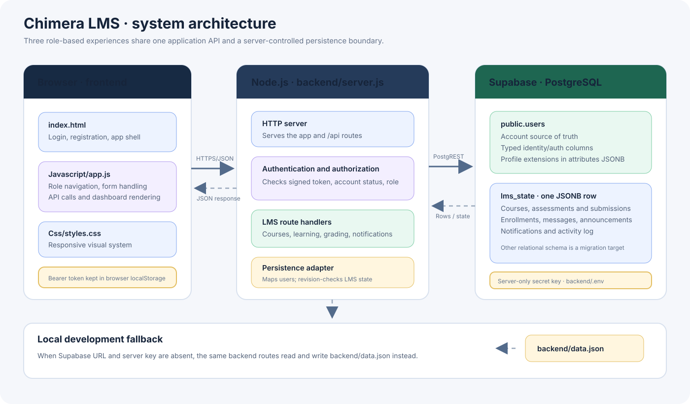
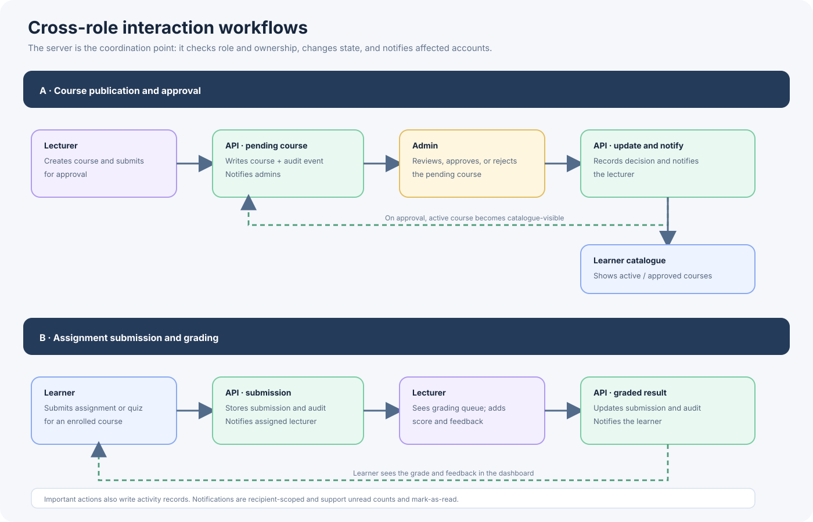
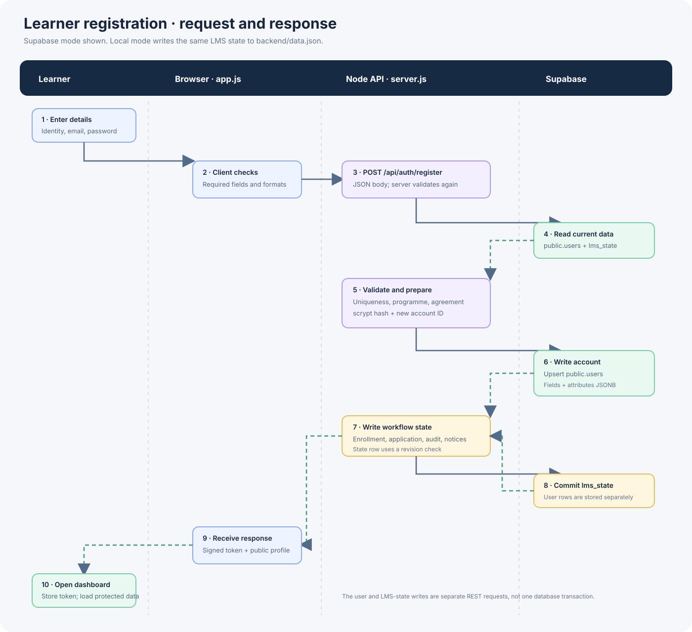

# Chimera LMS: code and system design

Chimera LMS is a browser-based learning management system for learners, lecturers, and administrators. The interface is a single-page application written in plain HTML, CSS, and JavaScript. A small Node.js HTTP server serves the website and its JSON API. Depending on its configuration, the backend persists data to Supabase or to a local JSON file.

## System at a glance

### Main components

| Component | Code | Responsibility |
| --- | --- | --- |
| Web shell | `index.html` | Login, registration, dashboard shell, modal and notification containers. |
| Browser application | `Javascript/app.js` | Form handling, role-specific navigation and dashboards, API calls, and rendering responses. |
| Presentation | `Css/styles.css` | Layout, responsive behavior, themes, dashboard components, and interaction states. |
| HTTP server and API | `backend/server.js` | Serves the frontend, validates requests, authenticates users, enforces roles, runs LMS workflows, and persists changes. |
| Seed/fallback data | `backend/data.json` | Local persistence when Supabase is not configured and seed data when a new Supabase state row is first initialized. |
| Supabase schema | `backend/postgres-schema.sql` | Creates the compatibility state table and the relational tables used by the LMS database design. |

The frontend does not connect directly to Supabase. It calls the Node API. The Supabase secret key stays on the server in `backend/.env`; it must never be placed in `Javascript/app.js` or sent to a browser.

## Frontend

### Application shell and navigation

`index.html` contains the public landing, login and registration screens, plus the authenticated application shell. `Javascript/app.js` switches between those screens and renders the dashboard sections. Navigation items are selected from the signed-in user's role:

- **Learner:** courses, assignments, learning paths, practice tests, calendar, progress, messages, and settings.
- **Lecturer:** courses, content, learner progress, assessment and grading, communication, schedule, and settings.
- **Admin:** users, courses and academic setup, content approval, admissions, attendance, communication, reports, and security settings.

The frontend keeps presentation state such as the active section, selected files, and cached API responses in JavaScript memory. It stores the returned login token in browser `localStorage` as `chimera_token`. The token is sent as an `Authorization: Bearer ...` header on later API calls.

### API client and error behavior

The `api()` helper in `Javascript/app.js` sends JSON requests to `/api`. When the app is opened from the Node server, the API uses that same origin. For a local file or a separate local preview server, it targets `http://127.0.0.1:5000`.

The browser checks form values to give quick feedback, but the backend validates them again. A successful API response updates the active view; an API error is shown in a toast or the relevant screen. If the backend cannot be reached, the API helper reports the connection problem. It does not provide a complete offline data store.

## Backend

### Request lifecycle

For each API request, `backend/server.js` parses the URL, loads current application state, verifies any bearer token, applies the route's role and ownership checks, and runs the route handler. Routes return JSON. The server also serves `index.html`, JavaScript, CSS, and assets for non-API requests.

The token is a signed HS256 JWT. The server verifies its signature and expiry, then resolves its user ID against the current user records. Protected routes reject missing users and inactive accounts. The UI hides sections by role, while the server independently enforces authorization; hiding a button is not an access-control boundary.

Passwords are hashed with Node.js `scrypt` and a per-account salt before storage. The built-in demo accounts are a development convenience and should not be used as production credentials.

### Cross-role workflows

The backend coordinates these workflows by updating the relevant record, adding activity-log entries, and creating notifications for affected users:

1. A lecturer publishes a course. It is stored as pending, appears in the admin approval queue, and is excluded from the learner catalogue until approved.
2. An admin approves or rejects it. The course status changes and the lecturer is notified. Approved courses become visible in the learner catalogue.
3. A learner submits an assignment. The submission is stored and the lecturer is notified; it appears in the grading queue.
4. A lecturer records a grade and feedback. The submission is updated and the learner is notified.
5. An admin deactivates an account. The account's status is persisted; future authenticated requests and sign-in attempts reject inactive accounts.

Notifications are scoped to their recipient. The API returns each user's notifications and supports marking them as read. The activity log records actions with the acting user's email and role.

### Registration: browser to database and back

1. The learner fills the registration form. The browser checks username format, matching email, identity/passport presence, and matching passwords.
2. The browser sends `POST /api/auth/register` with the form fields as JSON. The backend repeats validation, checks for duplicate email/username, and verifies the selected programme.
3. The backend hashes the password using `scrypt`, creates the learner account, and records the selected programme, initial enrollment, pending programme application, audit event, and admin notifications.
4. With Supabase enabled, the account is written to `public.users`. The remaining workflow data is written to `lms_state.state`, whose revision is incremented to detect stale concurrent updates. In local mode, the backend writes the state to `backend/data.json` instead.
5. Once persistence succeeds, the backend returns a signed token and a public profile. The browser saves the token, opens the learner dashboard, and loads its protected data through subsequent API requests.

Login follows a similar path: `POST /api/auth/login` looks up the user, validates the password and selected role, updates `lastLogin`, persists the change, and returns a token and public profile. Password hashes and recovery-answer hashes are never included in the public profile response.

## Data and persistence design

### Current Supabase storage boundary

When `SUPABASE_URL` and a server-side key are configured in `backend/.env`:

- **`public.users` is the source of truth for accounts.** Core account fields use typed columns such as `email`, `role`, `status`, `password_hash`, and `last_login_at`. Additional profile/workflow fields such as `selectedCourse`, `moduleProgress`, and the demo marker are stored in the JSONB `attributes` column.
- **`lms_state.state` stores the rest of the current application's state.** This includes courses, assignments, enrollments, submissions, notifications, announcements, messages, attendance, applications, and the activity log.
- **Legacy account migration:** on startup, the backend imports accounts from `lms_state.state.users` into `public.users`, then removes that array from `lms_state`. This requires `backend/users-table-migration.sql` to have been run in Supabase first.
- **Write behavior:** the backend sends account changes to the `users` Data API endpoint and non-user state changes to `lms_state`. State updates use a revision check to reject stale writes.

Without both Supabase settings, the backend uses `backend/data.json`. This fallback keeps local development possible. It is separate from the Supabase account table.

> **Transaction boundary:** a request that changes both an account and LMS workflow state currently makes separate Supabase REST writes. These are not one PostgreSQL transaction. If one write succeeds and the other fails, the records can temporarily diverge; check the server log and reconcile before retrying that operation.

### Relational target model

`backend/postgres-schema.sql` also defines relational tables for courses, course staff, modules, enrollments, programme applications, assessments, submissions, attendance, notifications, announcements, messages, activity, and sessions. These tables describe the intended normalized model, but current non-user API routes still read and write those entities through the `lms_state` JSONB document. Moving each workflow to its normalized table is a separate migration; the existence of a table in the schema does not mean the route uses it yet.

### Important data rules

- Each account has one role: `learner`, `lecturer`, or `admin`.
- Course ownership, enrollment, application, submission, and notification records refer to stable user IDs rather than display names.
- Password hashes, recovery hashes, and the Supabase secret key are private backend data.
- A learner-facing course catalogue should include approved/active courses only.
- Notifications have a recipient and read state; activity records retain the actor and action for audit history.
- Uploaded content is currently represented by the application's existing data flow; a production file-upload system should put file bytes in object storage and keep only metadata and storage keys in PostgreSQL.

## Security and operational notes

- Keep `SUPABASE_SECRET_KEY` and `JWT_SECRET` server-side. Do not commit `backend/.env`.
- The Supabase secret key has elevated database access. Browser requests must go through the Node backend, which performs authorization checks.
- Configure a unique, unpredictable `JWT_SECRET` for any shared or deployed environment; the built-in development fallback is not suitable for production.
- Use HTTPS, rate limits for authentication routes, secure password reset handling, database backups, and an explicit deployment secret manager before production use.
- Start locally with `cd backend` followed by `npm start`. The server requires Node.js 18 or newer.

## Design diagrams

The diagrams are SVG files in `assets/`, so they remain sharp when resized and are rendered directly in this Markdown page:

- [System architecture](assets/lms-system-architecture.svg)
- [Registration sequence](assets/lms-registration-sequence.svg)
- [Cross-role workflows](assets/lms-cross-role-workflows.svg)
