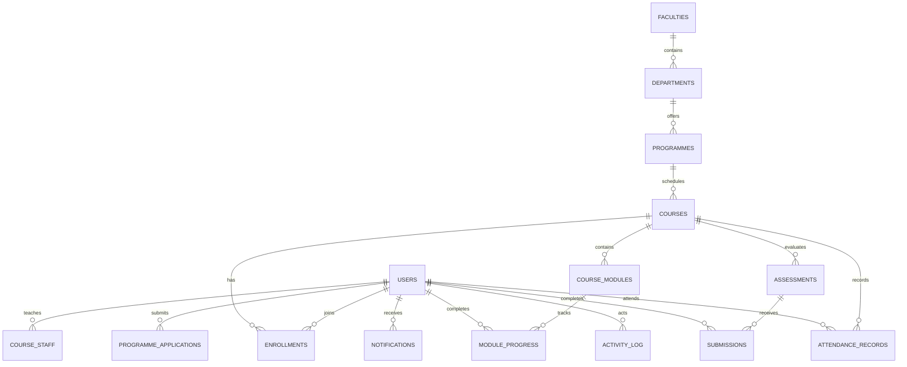

# PostgreSQL data model for Chimera LMS

`postgres-schema.sql` contains both the compatibility table used by `server.js` (`lms_state`) and the normalized relational target for three-role workflows. When Supabase environment settings are present, the server stores the non-user application state in `lms_state.state` and stores accounts in the normalized `users` table. Without those settings, it keeps using `data.json`.

## Enable Supabase persistence

1. Run `postgres-schema.sql` in the Supabase SQL Editor for a new project. For an existing installation, run `users-table-migration.sql` there first to add account metadata storage and restrict the table to the server role.
2. Set `SUPABASE_URL` and the server-only `SUPABASE_SECRET_KEY` in `backend/.env`. Existing installations may continue using `SUPABASE_SERVICE_ROLE_KEY`; the backend prefers `SUPABASE_SECRET_KEY` when both are set.
3. Start the Node server. If `lms_state` has no `main` row yet, the server seeds non-user state from `backend/data.json`. On first startup after this change, it imports legacy accounts from `lms_state.state.users` into `public.users`, then removes that array from the state row. Later requests read accounts from `public.users` and write account changes there; the remaining application state continues to use `lms_state`.
4. Keep `backend/.env` private. Never place the secret/service-role key in the browser or commit it. `/api/health` reports `persistence: "supabase"` when the backend is configured for Supabase.

The state-row bridge is suitable for preserving the current prototype behavior during connection work. It serializes all data into one JSON document, so it is not the final scalable relational design. Moving routes to `users`, `courses`, `enrollments`, `assessments`, and the other normalized tables is a separate migration phase.

## What the current backend stores

The JSON file currently has arrays for users, courses, assignments, enrollments, submissions, materials, programme applications, audit entries, and attendance. Runtime code also initializes notifications, messages, announcements, and quiz-attempt arrays. The schema includes these interaction entities even when their current JSON arrays are empty or absent.

The model normalizes nested course modules and learner progress. It also adds faculties, departments, programmes, academic terms, course staff, approval history, sessions, and quiz answer tables to support screens and workflows that do not yet have dedicated JSON entities.

## Core relationships

## JSON-to-PostgreSQL mapping

| JSON property/entity | PostgreSQL target | Migration notes |
| --- | --- | --- |
| `users[]` | `users` | Keep `id`; lowercase `email`; map `lastLogin` to `last_login_at`, `profileImage` to `profile_image`, and password/recovery hashes to the corresponding columns. Never migrate plaintext secrets. |
| `users[].selectedCourse` | `enrollments` and/or `programme_applications` | Resolve the title to a course by normalized title. Create an active enrollment only where it represents an actual registration. Preserve unmatched values in `requested_course_title` on an application or a migration exceptions report. |
| `courses[]` | `courses`, `programmes`, `course_staff` | Preserve course IDs and codes. The current course record also contains curriculum/programme-like data; initially create a matching programme row and link it, or leave `programme_id` null if programmes are managed separately. Map `instructorId` to `instructor_id` and course ownership to `course_staff`. |
| `courses[].modules[group][]` | `course_modules` | Insert one row for each module title. Preserve array order in `position` and group name in `group_name`; generate stable text IDs. |
| `courses[].status` | `courses.status` | Map legacy `in-progress` to `active`; map `pending`, `rejected`, and `archived` directly. Record pending/approved decisions in `course_approval_events`. |
| `courses[].students`, `courses[].progress` | Derived views | Do not treat these as source-of-truth counters. Derive active learner count from enrollments and progress from module completions. |
| `enrollments[]` | `enrollments` | Map `userId`/`courseId` and default missing status to `active`; preserve `enrolledAt` when present. Use `withdrawn` plus `ended_at` for future leave actions rather than deleting history. |
| `program_applications[]` | `programme_applications` | Map `userId`, course title, status, and `submittedAt`; resolve `course_id` when possible and always preserve the original title in `requested_course_title`. |
| `assignments[]` | `assessments` | Map `courseId`, `createdBy`, title, type, and due date. Normalize `due` to `due_at`. Treat learner completion as submissions, not as a shared assessment status. |
| `assignments[].quiz.questions[]` | `assessment_questions`, `assessment_options` | Store prompts and options in order. Store the answer key only in `is_correct`; API queries for learners must omit it. |
| `submissions[]` | `submissions`, `submission_answers` | Map learner, assessment, comments, file metadata, submitted time, score, feedback, and grading time. Decode legacy `fileContent` only for a one-time import; write files to object storage and retain `storage_key`, rather than putting base64 in normal database rows. |
| `materials[]` | `course_materials` | Resolve course code/id to `course_id`; store file metadata and a storage key. |
| `attendance[]` | `attendance_records` | One row per course, learner, and date. Map `markedBy` and `markedAt`. |
| `messages[]` | `course_messages` | Map sender, recipient, course, message, created time, and `read` to `read_at` (read timestamp). |
| `announcements[]` | `announcements` | Map system/course scope, audience, author, and course reference. The database constraint requires a course for course-scoped announcements and forbids one for system-wide announcements. |
| `notifications[]` | `notifications` | One notification per recipient. Map `read: false` to `read_at IS NULL`; setting `read_at` is the mark-as-read operation. |
| `audit_log[]` | `activity_log` | Map actor email/role/action/status/time. Keep actor email and role snapshots so history survives account changes or deletion. |
| JWT token/session | `user_sessions` | Store a hash of an opaque session token, never the token itself. Revoke sessions in the same transaction as account deactivation. |
| nested `moduleProgress` and `moduleNotes` on users | `module_progress`, `module_notes` | Resolve each course/group/index to its `course_modules.id`. Preserve completion time if available; otherwise use migration time. |

## Cross-role transaction boundaries

Perform each user-visible action as one database transaction. Insert the domain change, audit event, and all recipient notifications together; commit only when all writes succeed.

1. **Lecturer publishes a course:** insert a `courses` row with `pending` status; insert a `submitted` approval event; insert activity and notifications for admins.
2. **Admin approves/rejects:** update course status and reviewer fields; insert an approval event; notify the lecturer. Learner catalogue queries include only `active` courses.
3. **Learner enrols/leaves:** insert or update the `(learner_id, course_id)` enrollment. On leave, mark it `withdrawn` and set `ended_at`. Notify the lecturer/admin as appropriate and record activity.
4. **Learner submits work:** insert a submission and answers/file metadata; notify the course lecturer and add activity. The lecturer queue selects submissions with `graded_at IS NULL`.
5. **Lecturer grades:** update score, feedback, grader, and grading time; notify the learner and record activity in the same transaction.
6. **Admin deactivates a user:** set the user status to `Inactive`, revoke every active `user_sessions` row, then notify/audit. Every authenticated request must validate both the session and current user status.
7. **Notifications:** fetch unread counts with `WHERE user_id = $1 AND read_at IS NULL`; mark read by setting `read_at` for a notification owned by the authenticated user.
8. **Course content and announcements:** create/delete course modules, assessments, or announcements with recipient notifications and activity records in the same transaction. Keep authorization checks in the service layer and scope every query by course ownership or admin role.

## Migration order

Run `postgres-schema.sql`, then import in dependency order: faculties/departments/terms, programmes, users, courses, course staff, modules, applications, enrollments, assessments/questions/options, submissions/answers, materials, attendance, messages, announcements, notifications, audit events, sessions. Keep source JSON backups and produce a report for duplicate emails/codes, unresolved course titles, invalid dates, and references to missing users/courses. No JSON file should be deleted as part of the import.

## Important model choices

- IDs are `TEXT` primary keys so current IDs such as `u2` and `cert-data-science` can be retained; new IDs can still be UUID strings.
- Email and username have case-insensitive unique indexes. Normalize email to lowercase during import.
- Account role and status are stored on the user row because the current product gives each account one role. If users later need multiple simultaneous roles, replace the role column with a `user_roles` join table.
- `faculty`, `department`, `programme`, and `academic_term` assignments are not present on the current JSON course records. Those columns are optional until the admin forms collect the values.
- Registration currently creates a pending `program_applications` row and an enrollment at the same time. If application approval should gate course access, the PostgreSQL implementation should create the enrollment only after approval; otherwise keep the application and enrollment as separate concepts and make access policy explicit.
- `course_enrollment_counts` and `learner_course_progress` are read models; keep derived counts out of writes.
- Password hashing must continue to use a slow password hash. The current salt/hash fields can be imported, but use a dedicated authentication library and key management before production deployment.
